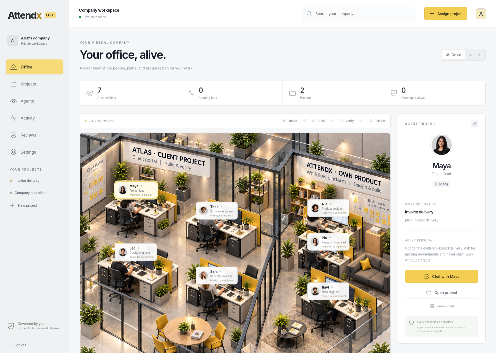

# Attendx — Your AI company, connected

A Dockerized live workspace with named AI agents, persistent projects, multi-provider chat and planning, isolated code verification, reviewable delivery artifacts, and a gray/yellow virtual office. This is an initial backend beta with explicit execution limits, not an unrestricted autonomous company.



## Start or update

Install/start Docker Desktop and Git. For a new checkout:

```sh
git clone --branch attendx-office-prototype https://github.com/Nighthacker-SVg/new-brain.git attendx
cd attendx
docker compose up --build -d --wait
```

For an existing checkout, run `git pull --ff-only`, then `docker compose up --build -d --wait`. Open `http://localhost:8080` **on the computer running Docker**. Node/npm are not required to run the app.

On Linux, if the runner cannot access the Docker socket, set `ATTENDX_DOCKER_GID` to the output of `stat -c '%g' /var/run/docker.sock` before starting Compose. Docker Desktop normally uses the default group. See [Docker setup](docs/docker.md) for cloud proxy certificates, another port, backups, and troubleshooting.

For a **Google Cloud trial with no paid AI API**, use the [private CPU deployment guide](docs/google-cloud.md). The prepared profile runs one shared local Ollama model, keeps app/model ports private, and stops the VM after a bounded session. Cloud compute and storage still consume credits; actual account permissions, quota and model quality must be checked on the deployed VM.

## Give the company real work

1. Create a workspace account with a password of at least 12 characters.
2. Open **Settings → Add provider**. Choose a preset/protocol and configure model access, or use keyless local Ollama. In the cloud local-only profile the first account receives the server-managed local connection; no paid key is needed. Remote AI providers are blocked in that profile.
3. Click **Assign project**. Describe the deliverable, acceptance criteria, budget and team. An optional public GitHub URL authorizes bounded, read-only source import.
4. Select **Generate plan**. Clarify the manager's questions in Chat, then generate an updated plan. Approve a complete plan in the project's reviews.
5. Select **Run approved plan**. The worker produces candidate files, executes supported checks in a disposable Docker container, and records real results. Failing executable tests may trigger one budgeted implementation repair; that repair cannot edit the original tests.
6. Open **Evidence** for source files, a source ZIP, diffs, test reports, and a static HTML preview when available. Review code and acceptance criteria before approving the release record. Approval does not push, merge, or publish a website.

Without a configured model, model jobs become visibly blocked; no AI responses or passing results are fabricated. External providers need their own model access. Ollama models must be installed and accessible; the cloud profile includes an explicit model-download step.

## Included capabilities

| Capability | Behavior |
| --- | --- |
| Persistent accounts/projects | Password hashing, expiring sessions, CSRF checks, account-scoped SQLite storage and durable queued jobs. Refreshing retains live state. |
| Multiple providers | OpenAI-compatible APIs and Anthropic; role routing, priority and at most one alternate provider per call. Keyless local Ollama is supported. |
| Local-only operation | Backend-enforced remote-provider denial, zero external API reservations for local calls, durable per-project call quota, bounded context/output and configurable CPU response timeout. |
| Named-agent chat | Individual personas, project-scoped history and approved memory. Chat cannot silently change permissions or deploy code. |
| Project delivery | Plan approval, candidate source, actual Node/Python checks, test evidence, ZIP, diffs and sandboxed static HTML previews. |
| Bounded hiring | Allowlisted role templates, maximum 12 agents/account, project-scoped specialist authority, spending ceiling and expiry. Manager-proposed hires require owner review. |
| Memory/improvement | Owner-approved project memory; baseline/candidate instruction evaluations with explicit fixtures; approved promotion and rollback. Versions stay project-scoped. |
| Knowledge retrieval | Lightweight scoped lexical search finds relevant approved memories and saved research extracts, with a bounded model-context budget. External sources remain untrusted. |
| Controlled research | A project Research tab queues public GitHub repository/README discovery or reads up to three allowlisted HTTPS sources. Evidence includes source URLs, timestamps, fetch errors and an optional unverified model summary. |
| Ongoing verification | Up to six schedules/account periodically rerun checks on existing candidate files. This does not monitor a publicly deployed product. |
| Live office/motion | Server-sent events, coalesced refreshes, actual job/status/budget indicators, active-job beacons, responsive layouts, keyboard dialogs and reduced-motion support. |

## Current boundaries

- Execution supports **dependency-free Node.js and Python standard-library projects**. Jobs have no network or package installation. Applications needing npm/pip dependencies, databases or external services require a future approved execution profile.
- Public repository import is limited to 60 safe UTF-8 text files, 120 KB/file, 600 KB total and a 180 KB model-context limit. Private, binary-heavy or larger repositories fail explicitly. No automatic push, merge or deployment occurs.
- HTML previews are static, sandboxed and have scripting disabled; they are not deployed full-stack previews.
- Improvement changes evaluated instructions and produces reviewable code candidates. Agents cannot replace their running control plane, retrain model weights, expand permissions or alter budgets/audit records.
- External-model amounts are conservative **reservations**, not verified invoices. Local calls use a separate durable compute quota and record zero external API expense. VM, storage, network and electricity costs are separate.
- Research is a bounded source-reading tool, not general web search or unattended crawling. It does not run website JavaScript, use login cookies, execute downloaded content, automatically approve facts or train model weights.
- Voice, arbitrary browser automation, private-repository integrations, SSO/password recovery, production infrastructure and public domain/HTTPS hosting are not included.

See the [readiness and security report](docs/readiness.md). The earlier sample office remains explicitly available at `/?demo=1` and resets on refresh.

## Architecture and data

Compose starts `web` (Nginx), `api` (Node 24 control plane/durable worker) and `runner` (private Docker execution broker). Only web port 8080 is published, on loopback. Generated jobs never receive host mounts, provider credentials, the control key or a Docker socket. The broker alone has daemon access and is a trusted administrative component.

The `attendx_data` volume holds SQLite/journals and a separate provider encryption master key. `attendx_control` holds the runner key. Back up both while stopped; losing the master key makes saved provider credentials unreadable. `docker compose down` retains data. Do not use `down --volumes` for the normal workspace.

## Developer checks

With Node 24, locked dependencies and Chromium/Playwright installed:

```sh
npm ci
npm run build
npm run test:server
npm run test:runner
npm run test:live
npm run test:local
python3 deploy/gcp/test_deployment.py -v
```

`test:runner` needs Docker. `test:live` and `test:local` expect the three app images already built; each creates a random isolated Compose project, adds a deterministic HTTP model fixture, runs browser checks and removes only its own test containers/data. They use no paid model billing and do not measure actual model quality. The cloud script checks use stubbed `gcloud`, not a real cloud account. Tests use `/usr/bin/chromium`, `ATTENDX_CHROMIUM_PATH`, or an installed Playwright Chromium (`npx playwright install chromium`).

For frontend editing, keep Docker running and use `npm run dev -- --host 0.0.0.0 --port 4174 --strictPort`; Vite proxies `/api` through the local Docker web service. Dev host/CORS protections remain enabled. Cloud tasks already have isolated workspaces; use the existing checkout unless a worktree is explicitly requested.
