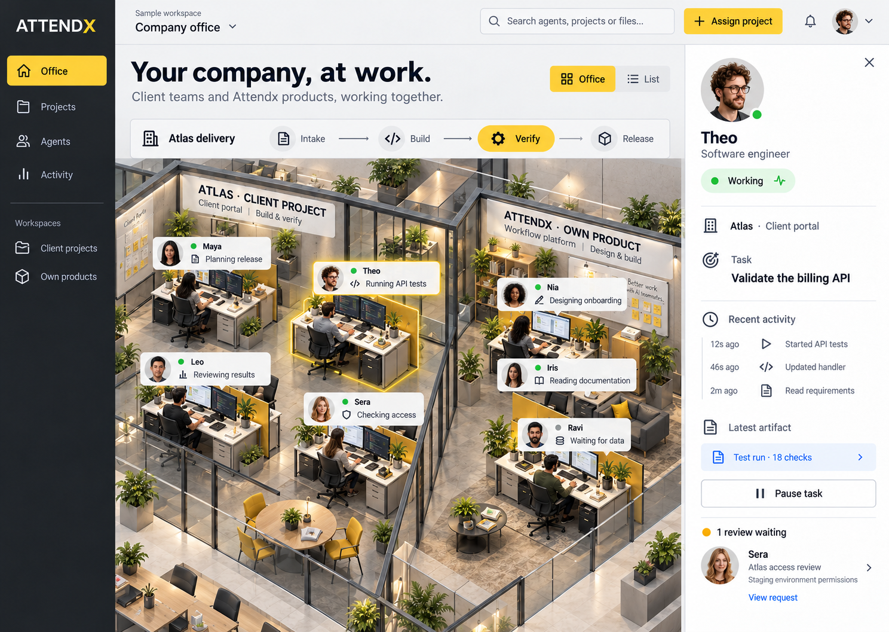
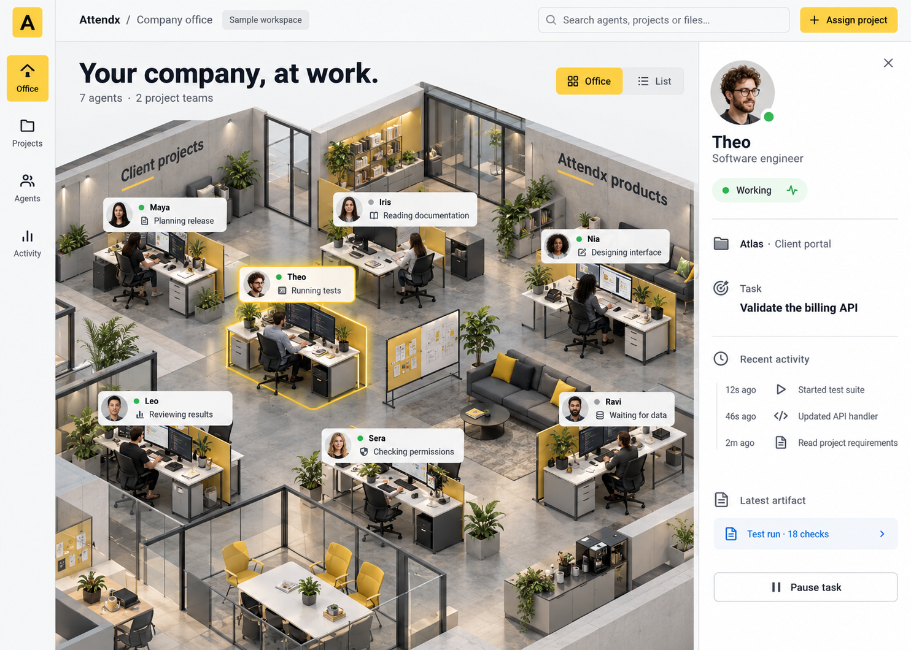
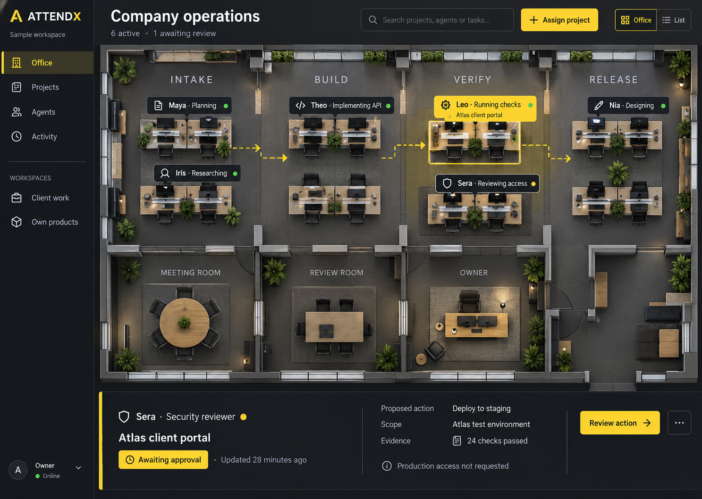
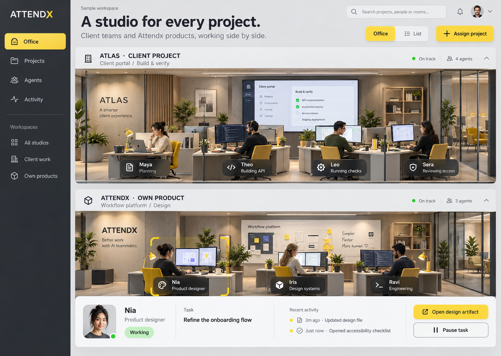

# Attendx office design previews

## Combined concept

This concept combines the open office and agent inspector, the delivery stages and review visibility, and separate studios for client projects and Attendx products. Gray and yellow remain the core theme.

This is a static visual concept with sample activity, for review before implementation.

---

## Original concepts

Three visual concepts for Attendx's gray-and-yellow virtual office. These are static design mockups with sample activity.

### Option 1

### Option 2

### Option 3

Click an image to open it at full resolution. No application code or live agent services are included.
