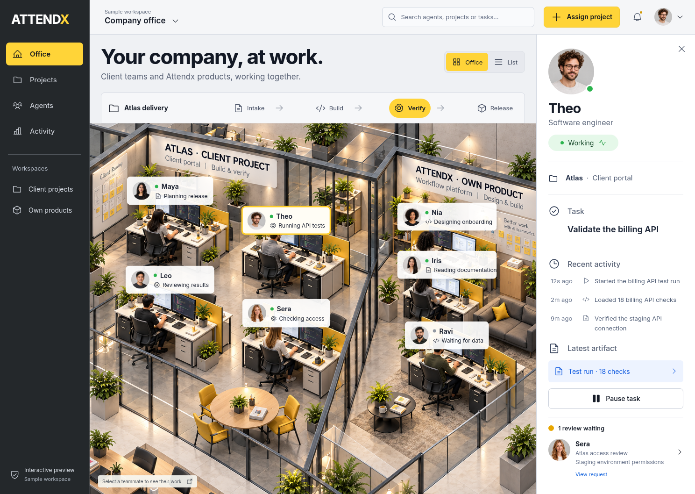

# Attendx — Your company, at work

An interactive implementation of the approved gray-and-yellow virtual office, with client studios, product teams, named agents, delivery stages, and an activity inspector.



## Current scope

This is a responsive frontend prototype using clearly labeled sample data. Project assignments, task controls, and review decisions update the current browser session. Refreshing restores the sample workspace.

- Select any of seven agents in the office or the keyboard-accessible list.
- View projects, tasks, observed sample actions, and artifacts.
- Pause and resume sample tasks.
- Search and filter agents, projects, workspaces, stages, and activity.
- Create a project and assign its team.
- Approve or decline a sample staging access request.
- View and download an explicitly labeled sample artifact.
- Use responsive mobile navigation and dialogs with keyboard focus support.

Live AI execution, server-side authorization, authentication, persistent storage, public hosting, and autonomous hiring remain future integrations. Review controls currently change demo state; they do not enforce external permissions.

## Develop

Tested with Node **24.19.0** and npm **11.9.0**. The Node pin is in `.node-version`; dependency versions are locked.

```sh
npm ci
npm run dev -- --host 0.0.0.0 --port 4173 --strictPort
```

Use the existing checkout. Cloud tasks already have an isolated workspace; create a separate Git worktree only when explicitly requested.

## Validate

```sh
npm run build
npm run test:e2e
```

The build includes TypeScript checking. Eleven Playwright tests cover main user journeys, state regressions, keyboard dialogs, sample exports, tablet controls, mobile navigation, asset loading, browser errors, page overflow, and rendering/interactions inside a restricted embedded frame. The runner builds and starts a separate production preview on port 4175; `ATTENDX_BASE_URL` can target an existing production preview instead.

Tests use `/usr/bin/chromium` when installed. Set `ATTENDX_CHROMIUM_PATH` for another executable. On a machine without Chromium, run `npx playwright install chromium` first.

## Production build

```sh
npm run web-preview
```

This builds and serves the compiled `dist/` site on port 4173. Use this command for embedded web previews, where the development server's module and refresh requests can be blocked. Only the public static preview enables cross-origin asset reads; the development server keeps its access restrictions. Sample project actions do not require native form submissions or secure-context UUID APIs. The host frame still controls native file-download support.

The `dist/` directory can be deployed to a static host. Public hosting is not configured by this change.

## Design evidence

- [Approved combined concept](combined-office.png)
- [Desktop browser screenshot](docs/preview/office-desktop.png)
- [Mobile browser screenshot](docs/preview/office-mobile.png)
- [Project assignment dialog](docs/preview/assign-project.png)
- [Design QA and verification](design-qa.md)

The office scene and seven portraits are generated raster assets. Icons come from Phosphor; Inter is bundled locally. There are no third-party runtime image or font requests.

## Connecting real agents

Keep model credentials, client data boundaries, spending limits, and authorization in a server-side service. Feed the UI recorded task/tool events, redacting sensitive fields before display. The office and frontend controls are presentation, not a security boundary. Provider credentials belong outside browser code and `VITE_` variables.
